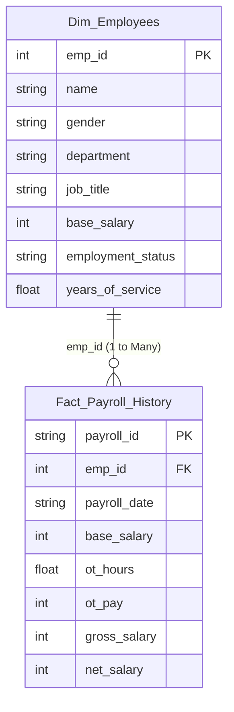

# 📊 Power BI Executive Dashboard Blueprint
> **ပရောဂျက်ခေါင်းစဉ်:** Enterprise HR Workforce & Payroll Intelligence Dashboard  
> **ဒေတာအရင်းအမြစ်:** `data/PowerBI_HR_Workforce_Dataset.xlsx`

---

## ၁။ Power BI ဆိုတာ ဘာလဲ? ဘာကြောင့် သုံးရတာလဲ?
- Microsoft မှ အခမဲ့ ထုတ်လုပ်ထားသော Business Intelligence & Data Visualization Software ဖြစ်ပါသည်။
- ကုဒ်မရေးတတ်သော CEO, CFO, HR Director များအတွက် Mouse ဖြင့် Click နှိပ် filter လုပ်နိုင်သည့် **အရောင်အသွေးစုံ Interactive Dashboard** များ ဖန်တီးရာတွင် သုံးပါသည်။

---

## ၂။ Data Model (Star Schema) ချိတ်ဆက်ပုံ
Power BI ထဲသို့ `PowerBI_HR_Workforce_Dataset.xlsx` ကို ထည့်သွင်းလိုက်သောအခါ Sheet (၂) ခု ပါရှိပါသည်:



- **`Dim_Employees` (Dimension Table - ဝန်ထမ်းအချက်အလက်):** ဝန်ထမ်းတစ်ဦးချင်းစီ၏ နာမည်၊ ဌာန၊ ရာထူး၊ အခြေခံလစာ (Rows 500 ခု)
- **`Fact_Payroll_History` (Fact Table - ငွေကြေးမှတ်တမ်း):** လစဉ် လစာထုတ်ပေးခဲ့သည့် မှတ်တမ်းများ (Rows 5,097 ခု)
- **ချိတ်ဆက်သည့်သော့ (Relationship Key):** `emp_id`

---

## ၃။ အရေးကြီးသော DAX Measures (ဖော်မြူလာများ)
Power BI ထဲတွင် "New Measure" ကို နှိပ်ပြီး အောက်ပါ DAX ၄ ခုကို ရေးသားရပါသည်:

1. **စုစုပေါင်း ဝန်ထမ်းဦးရေ (Total Headcount):**
   ```dax
   Total Headcount = COUNTROWS(Dim_Employees)
   ```

2. **လက်ရှိ တာဝန်ထမ်းဆောင်ဆဲ ဝန်ထမ်းဦးရေ (Active Headcount):**
   ```dax
   Active Headcount = 
   CALCULATE(
       COUNTROWS(Dim_Employees),
       Dim_Employees[employment_status] = "Active"
   )
   ```

3. **စုစုပေါင်း လစာ ကုန်ကျစရိတ် (Total Payroll Cost):**
   ```dax
   Total Payroll Cost = SUM(Fact_Payroll_History[gross_salary])
   ```

4. **ပျမ်းမျှ လစာ (Average Salary):**
   ```dax
   Avg Base Salary = AVERAGE(Dim_Employees[base_salary])
   ```

---

## ၄။ Dashboard ပေါ်တွင် တည်ဆောက်ရမည့် Visuals (၄) ခု
1. **ထိပ်ဆုံးအတန်း (KPI Cards):**
   - Active Headcount (၄၀၆ ဦး)
   - Total Annual Payroll (10.2 Billion MMK)
   - Avg Monthly Salary (1.75 Million MMK)
2. **ဘယ်ဘက် (Clustered Bar Chart):**
   - X-axis: `Total Payroll Cost`
   - Y-axis: `department` (Engineering, Sales, Marketing, etc.)
3. **ညာဘက် (Donut Chart):**
   - Legend: `gender` (Female / Male)
   - Values: `Active Headcount`
4. **ဘေးဘောင် (Interactive Slicers / Filters):**
   - Slicer 1: `department` (ရွေးချယ်လိုက်သော ဌာန၏ data သာ တစ်ပြိုင်နက် ပြောင်းလဲသွားမည်)
   - Slicer 2: `employment_status` (`Active` / `Resigned`)
